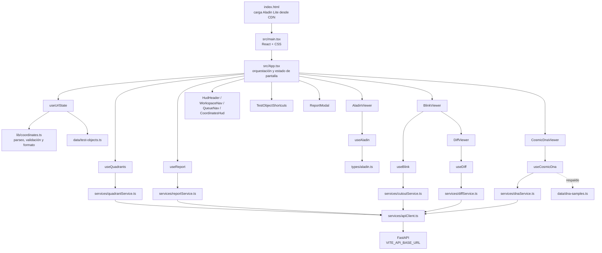

<!-- Assisted by Codex (SI) — reviewed by pendiente -->

# SpectraHive Frontend — mapa de arquitectura para agentes

Resumen orientado a encontrar rápido los archivos que hay que leer o editar. Describe el código presente en este repo y separa los hechos observados de los requisitos del proyecto.

> **Fuente de verdad:** [`spec/00-contexto-general.md`](spec/00-contexto-general.md). Si este mapa o el código contradicen esa especificación, manda la especificación. Antes de cambiar stack, requisitos, contratos, modelo de datos, alcance, objetos o Docker, aplica RN-14 y detente para avisar al equipo.

## Lectura rápida

- Aplicación SPA: Vite + React 19 + TypeScript estricto + Tailwind 4; entrada en `src/main.tsx`, composición principal en `src/App.tsx`.
- La UI está en inglés. El estado de coordenadas/FOV se serializa como query params de URL con `useUrlState`.
- Hay **dos visores con propósitos distintos**: `AladinViewer` muestra el cielo navegable de Aladin Lite; `BlinkViewer` presenta los cutouts de dos épocas que recibe del backend.
- Las llamadas HTTP están en `src/services/`, centralizadas por `apiClient.ts`; hooks conectan esos servicios con los componentes.
- El catálogo de cinco objetos y el ADN local de respaldo están en `src/data/`.
- No se encontró `docker-compose.yml` en este repo. El `Dockerfile` local sí existe; la documentación dice que Compose vive en el repo de integración.

## Grafo de la aplicación

## Capas y responsabilidades

| Capa | Ubicación | Responsabilidad / regla para editar |
| --- | --- | --- |
| Arranque y configuración | `index.html`, `src/main.tsx`, `vite.config.ts`, `tsconfig.json` | CDN de Aladin, montaje React, Tailwind, servidor Vite y tipado estricto. La integración Aladin global se declara en `src/types/aladin.ts`. |
| Orquestación | `src/App.tsx` | Estado de pantalla y handlers: URL, cuadrante activo, centro/FOV del mapa, selección/hover, modales y conexiones entre componentes. Para cambiar flujo de usuario, empezar aquí y seguir el hook/componente afectado. |
| Componentes | `src/components/{layout,search,blink,report,adn,ui}/` | Presentación y eventos. Mantener HTTP fuera de los componentes. El shell usa un marco perimetral con cabecera, herramientas y datos anclados a la izquierda, mapa central, inspector derecho y cola inferior. Los paneles permanecen desplegados. Ver `docs/diseno-minimalismo-tactico.md`. |
| Hooks | `src/hooks/` | Estado y efectos de dominio/UI: URL, Aladin, cola, blink, diff, ADN y reporte. Normalmente son el punto de unión entre componente y servicio. |
| Servicios | `src/services/` | Único lugar con `fetch`; serializa parámetros/JSON y usa `fetchApi`. No cambiar contratos de manera unilateral. |
| Tipos | `src/types/` | DTOs de API (`api.ts`), objetos/coordenadas frontend (`quadrant.ts`) y tipos mínimos del SDK global (`aladin.ts`). Cambios de contrato requieren actualizar la fuente de verdad primero. |
| Dominio puro y constantes | `src/lib/` | Parseo/validación/formato de RA/Dec, FOV admitido y encuestas HiPS. Sin React ni llamadas HTTP. |
| Datos locales | `src/data/` | Coordenadas J2000 de los cinco objetos (`test-objects.ts`) y firmas de ADN de respaldo (`dna-samples.ts`). No inventar ni modificar valores astronómicos sin revisar la especificación. |
| Estilos | `src/styles/index.css` + clases Tailwind | CSS global mínimo y utilidades. La mayoría del aspecto está en clases del JSX. |

## Flujo principal y archivos

### 1. URL, coordenadas y cola

1. `useUrlState` lee `ra`, `dec`, `fov` al montar y al recibir `popstate`.
2. `lib/coordinates.ts` convierte decimal/sexagesimal, valida rangos y formatea URL/display.
3. `data/test-objects.ts` identifica un objeto de prueba cercano y define el valor inicial (Barnard).
4. `useQuadrants` carga la cola del backend y mantiene un fallback local; `QuadrantQueueNav` presenta navegación.
5. `App` propaga las selecciones a Aladin, al visor Blink y al URL mediante callbacks.

**Archivos a revisar juntos:** `src/App.tsx`, `src/hooks/useUrlState.ts`, `src/hooks/useQuadrants.ts`, `src/lib/coordinates.ts`, `src/data/test-objects.ts`, `src/components/layout/QuadrantQueueNav.tsx`, `src/components/search/TestObjectShortcuts.tsx`.

### 2. Aladin y Blink/diferencia

- `index.html` expone `window.__loadAladinLite` / `window.__aladinPromise` y busca cargar Aladin Lite desde varios CDN.
- `useAladin` crea y destruye la instancia, conecta eventos del mapa y actualiza centro, FOV, encuesta y marcador. Las definiciones globales están en `types/aladin.ts`.
- `AladinViewer` es el adaptador visual de ese hook.
- `useBlink` pide cutout A y B en paralelo, guarda las respuestas en una caché en memoria y alterna épocas; `BlinkViewer` contiene controles y selección sobre el cutout.
- `useDiff` carga la imagen de diferencia y candidatos; `DiffViewer` expone los candidatos a `BlinkViewer`/`App`.
- El cálculo de `|B−A|` y el umbral corresponden al servicio backend, no a React.

**Archivos a revisar juntos:** `src/components/blink/{AladinViewer,BlinkViewer,DiffViewer}.tsx`, `src/hooks/{useAladin,useBlink,useDiff}.ts`, `src/services/{cutoutService,diffService}.ts`, `src/types/{aladin,api}.ts`, `index.html`.

### 3. Reporte y validación

`ReportModal` obtiene el tipo recomendado a partir de `tipo_prueba`, presenta opciones de movimiento/brillo/limpio y llama a `submitReport` de `useReport`. El hook usa `reportService` para crear un reporte y, para anomalías, solicita tres validaciones simuladas. `App` actualiza el estado local de la cola tras el éxito.

**Archivos a revisar juntos:** `src/components/report/ReportModal.tsx`, `src/hooks/useReport.ts`, `src/services/reportService.ts`, `src/types/api.ts`, `src/App.tsx`.

### 4. ADN Cósmico

`CosmicDnaViewer` dibuja el código de barras y deja comparar perfiles de referencia. `useCosmicDna` intenta cargar el objeto por servicio y usa `FALLBACK_DNA_SAMPLES` si falla. El contenido debe seguir presentado como **firma visual comparativa**, no identificación química.

**Archivos a revisar juntos:** `src/components/adn/CosmicDnaViewer.tsx`, `src/hooks/useCosmicDna.ts`, `src/services/dnaService.ts`, `src/data/dna-samples.ts`, `src/types/api.ts`.

## Mapa de servicios y contratos observados

Todas las rutas usan el prefijo `VITE_API_BASE_URL` (por defecto `http://localhost:8000`) desde `src/services/apiClient.ts`. El cliente aplica timeout, JSON y errores `ApiError`.

| Servicio | Uso en frontend observado | Referencia normativa |
| --- | --- | --- |
| `quadrantService.ts` | `GET /quadrants` → `{ cuadrantes: [...] }` | RF-05 requiere cola fija de 10; esta ruta no aparece en §6 de contratos. |
| `cutoutService.ts` | `GET /cutout?ra&dec&fov&epoca&formato`; espera `imagen` Data URI además de los campos de cutout | §6 especifica `/cutout?ra&dec&fov` y respuesta con imagen + `{ra,dec,fov,epoca,fuente}`. Alinear implementación y backend conforme al contrato acordado. |
| `diffService.ts` | `POST /diff` con `{cuadrante_id, epoca_a, epoca_b}`; espera `imagen`, `umbral`, `candidatos` | Coincide en endpoint y campos principales con §6. |
| `reportService.ts` | `POST /report`; luego `POST /report/{reporte_id}/validate` con `{coincide, es_simulado}` | `/report` figura en §6. La ruta de validación detallada no está en §6; RF-12/RF-13 sí definen el comportamiento esperado. |
| `dnaService.ts` | `GET /dna/{slug}` y fallback local | §6 define el formato del ADN, pero no una ruta HTTP. Confirmar que el endpoint está acordado con backend antes de cambiarlo. |
| `apiClient.ts` | `GET /health` disponible vía `checkBackendHealth()` | Ruta auxiliar observada; no se invoca desde la pantalla principal. |

## Rutas de edición por objetivo

| Si el agente necesita… | Empezar por… | Seguir con… |
| --- | --- | --- |
| Cambiar parseo/coordenadas/URL | `src/lib/coordinates.ts` | `src/hooks/useUrlState.ts` → `src/App.tsx` → UI de búsqueda/HUD |
| Ajustar un objeto de prueba | `docs/spec/00-contexto-general.md` §5 | `src/data/test-objects.ts` → `src/data/dna-samples.ts` si aplica → componentes que muestran su tipo |
| Cambiar carga/animación de épocas | `src/hooks/useBlink.ts` | `src/services/cutoutService.ts` → `src/types/api.ts` → `BlinkViewer.tsx` |
| Cambiar diferencia, umbral o candidatos | `docs/spec/00-contexto-general.md` RF-08/RF-09/§6 | `src/services/diffService.ts` → `src/hooks/useDiff.ts` → `DiffViewer.tsx` |
| Cambiar reporte/consenso | `docs/spec/00-contexto-general.md` RF-10…RF-13/§6 | `reportService.ts` → `useReport.ts` → `ReportModal.tsx` → `App.tsx` |
| Cambiar ADN | `docs/spec/00-contexto-general.md` RF-14/RF-15/§6 | `dnaService.ts`/`dna-samples.ts` → `useCosmicDna.ts` → `CosmicDnaViewer.tsx` |
| Cambiar integración de Aladin | `index.html` + `src/types/aladin.ts` | `src/hooks/useAladin.ts` → `src/components/blink/AladinViewer.tsx` → `src/App.tsx` |
| Cambiar estructura visual | componente de `src/components/` | `src/App.tsx` para montaje/props; `src/styles/index.css` para estilos globales |
| Cambiar build/entorno | `package.json`, `vite.config.ts`, `tsconfig*.json`, `Dockerfile`, `.env.example` | Revisar RN-13/RF-17 y confirmar ubicación del Compose de integración |

## Diferencias y límites observados

Esta sección es un inventario de lectura estática, no una propuesta de cambio de contratos.

1. **Cola:** RF-05 pide 10 cuadrantes (cinco de prueba + cinco de práctica). El fallback en `useQuadrants.ts` se construye solo desde `TEST_OBJECTS`, así que contiene cinco. El frontend sí intenta obtener la cola por `GET /quadrants`.
2. **Búsqueda manual RA/Dec:** RF-01 contempla introducir coordenadas, pero no aparece un componente/formulario para introducir RA y Dec. El usuario puede abrir una URL con esos parámetros, usar los atajos de objetos o seleccionar el cielo; `HudHeader` y `CoordinatesHud` muestran coordenadas pero no tienen campos de búsqueda. El UI en código es, por tanto, más limitado que el flujo descrito.
3. **Rutas de API adicionales:** el código consume `/quadrants`, `/dna/{slug}` y `/report/{id}/validate`; solo `/cutout`, `/diff` y `/report` están enumerados como contratos en §6. `cutoutService.ts` también manda `epoca` y `formato`.
4. **Identificadores del fallback:** los IDs offline son `fallback-*`; el formulario usa ese valor como `cuadrante_id` para crear reporte. La compatibilidad depende de que el backend acepte esos IDs o traduzca el cuadrante; no puede afirmarse desde este repo.
5. **Persistencia de estado tras reporte:** `App` actualiza el estado del cuadrante en memoria al tener éxito. El backend puede persistir su estado, pero el frontend no vuelve a consultar la cola en ese handler.
6. **FOV del mapa:** la UI ofrece FOV 1/2 según requisitos, mientras que el usuario también puede hacer zoom con Aladin. `liveFov` refleja el zoom del visor; el estado compartido/URL se gestiona por separado desde los controles de FOV.
7. **Docker:** hay `Dockerfile` de desarrollo y configuración Vite para host/polling; no existe `docker-compose.yml` en este checkout. La instrucción del repo indica que pertenece al repo de integración.
8. **Pruebas:** `tsconfig.json` incluye el directorio `tests`, pero el inventario de archivos actual no muestra una suite de pruebas en este repo.

Resolver discrepancias que afecten endpoints, datos, requisitos o alcance requiere acuerdo del equipo y actualización previa de `docs/spec/00-contexto-general.md` (RN-14). Los detalles menores del frontend se pueden corregir siguiendo el proceso normal del repo.

## Convenciones operativas para agentes

- Leer `AGENTS.md` y la sección relevante de `docs/spec/00-contexto-general.md` antes de editar. Para el frontend, leer también [`roles/01-frontend-blink.md`](roles/01-frontend-blink.md).
- Textos de interfaz en inglés; este documento puede estar en español porque es documentación interna.
- Mantener TypeScript estricto, componentes funcionales y una sola responsabilidad por archivo.
- HTTP solo desde `src/services/`; lógica pura a `src/lib/`; estado React/efectos a hooks.
- No añadir dependencias, cambiar stack, contratos, coordenadas o alcance sin seguir RN-14.
- El flujo esperado por producto es: búsqueda RA/Dec → Blink A/B → resta y umbral → reporte → ADN visual → validación cruzada.
- Comandos documentados: `npm run dev`, `npm run typecheck`, `npm run build`, `npm run preview`. El Docker local sirve para desarrollo/pruebas; Vercel publica el build estático.

## Archivos de contexto

- [`AGENTS.md`](../AGENTS.md): reglas para agentes y estructura esperada.
- [`docs/spec/00-contexto-general.md`](spec/00-contexto-general.md): fuente de verdad de RF/RN, datos, modelo y contratos.
- [`docs/roles/01-frontend-blink.md`](roles/01-frontend-blink.md): responsabilidad y definición de listo del módulo.
- [`README.md`](../README.md): configuración del repo y declaración de uso de IA.
- `src/App.tsx`: punto de entrada para entender la pantalla completa.
